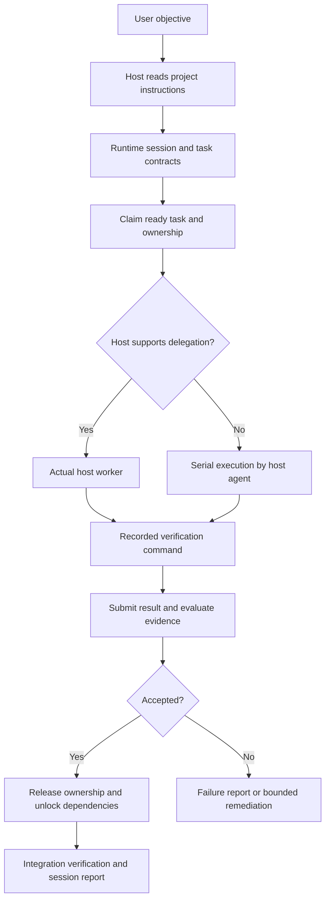

# Architecture

## Responsibility boundaries

| Layer | Responsibility | Does not imply |
| --- | --- | --- |
| Skill | Interpret the user's request, select a workflow, connect host tools to runtime | A running daemon or additional permissions |
| Python runtime | Validate tasks, persist state, claim ownership, record actual checks, produce reports | Autonomous model calls or enforcement over every host file tool |
| Host adapter | Describe dispatch capabilities and a worker envelope for the coding host | A generic API that works on every editor |
| Role definition | Task-specific guidance and result contract | A separate worker exists before actual host delegation |

Codex is the first integration target. The host agent resolves the installed plugin root from the skill path, starts runtime sessions, claims ready tasks, and delegates through the available host API. The runtime itself does not call Codex, invoke models, or emulate subagents.

## Session flow

## Scheduling and ownership

Dependencies form a directed acyclic graph. Only ready tasks can be claimed. Concurrency is limited by both configuration and actual host capacity. Exact workspace-relative file allowlists make ownership reviewable; shared files should be assigned to one worker or a later integration task.

Cross-process locks are cooperative. Workers must obtain claims and follow their allowlists. Locks do not intercept arbitrary editor writes, external processes, or unregistered tools. Diff review supplements ownership and evidence, but it is not a general filesystem sandbox.

## Verification

Checks run as argument lists, without a shell, and record outputs and exit codes. Completion uses recorded check identifiers rather than a worker's claim that a command passed. The host still chooses checks that assess the acceptance criteria; an irrelevant passing command does not establish product correctness.

After edits that invalidate earlier evidence, rerun the affected checks before claiming the changed work is verified. Independent review is useful for substantial changes; do not spawn ceremonial reviewers for a trivial edit.

## Persistence and recovery

Every session has its own durable state and reports under the configured state directory. Reports are views of state, not a replacement for it. Preserve historical sessions and decision records.

Recovery requires evidence that a worker stopped before releasing its ownership. A timeout suggests investigation; it cannot prove that a host worker is dead. Retry budgets limit loops. External effects whose outcome is unknown require reconciliation rather than blind replay.

## Configuration and authority

Defaults support English communication and project-driven UI conventions. Explicit user instructions and repository requirements take priority. Workflow size, concurrency, timeout, retries, and state directory are configurable where supported by the runtime; additional guidance settings can be stated in project instructions.

The user proxy advises on routine choices. It cannot manufacture permission to deploy, publish, delete data, send messages, or expand the requested scope.
